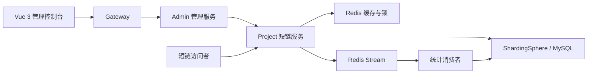

<div align="center">
  
  <h1>LinkFlow</h1>
  <p>短链接管理与访问分析平台</p>
  <p>让分享更轻便，让访问可追踪。</p>
  <p>短链生成 · 分组管理 · 访问分析 · 全栈管理控制台</p>
  <p>
    
    
    
    
    
  </p>
  <p><a href="#系统架构">系统架构</a> · <a href="#核心技术栈">技术栈</a> · <a href="#快速开始">快速开始</a> · <a href="启动.md">完整启动指南</a></p>
</div>

## 项目介绍

LinkFlow 面向短视频分享与内容推广场景，提供长链接转换、批量创建、分组管理、回收站与访问分析功能。管理端负责链接运营，跳转端借助缓存与异步统计处理访问请求，帮助使用者了解链接的传播效果。

短视频分享是项目的示例场景；系统不依赖第三方内容平台的账号或数据接口。

## 核心能力

| 能力 | 当前实现 |
| --- | --- |
| 短链创建 | 单条与批量创建、有效期设置、目标地址校验 |
| 链接管理 | 分组、分页查询、编辑、回收站恢复与删除 |
| 快速跳转 | Hash + Base62 短码、Redis 缓存、空值缓存、布隆过滤器及互斥锁 |
| 访问分析 | PV、UV、独立 IP，以及地域、设备、浏览器等维度的分析看板 |
| 异步统计 | Redis Stream 投递访问事件，消费者处理统计落库与消息去重 |
| 接口治理 | Gateway 鉴权、Nacos 服务发现、Sentinel 限流、Redis Lua 用户频控 |

## 系统架构



本地可使用 Aggregation 合并运行 Admin 与 Project；Gateway 在聚合模式下路由管理接口，短链访问直接到达聚合服务。

## 核心技术栈

| 层次 | 技术与用途 |
| --- | --- |
| 后端服务 | Java 17 · Spring Boot 3 · Spring Cloud：服务组织与业务接口 |
| 数据存储 | MySQL · MyBatis-Plus · ShardingSphere：持久化、分片与短链路由 |
| 缓存与事件 | Redis · Redisson · Redis Stream：缓存、分布式锁与异步统计 |
| 服务治理 | Gateway · Nacos · Sentinel：入口鉴权、服务发现与流量控制 |
| 前端控制台 | Vue 3 · Vite 8 · Element Plus · ECharts 6：管理交互与可视化 |

具体依赖版本以根目录 `pom.xml` 和 `console-vue/package-lock.json` 为准。

## 关键实现

- **短链生成与跳转**：生成短码时结合布隆过滤器和数据库约束处理重复；访问时优先读取缓存，并结合空值缓存和互斥锁双重检查缓解穿透与击穿。
- **分片与路由**：按分组标识组织短链分表，另设完整短链路由表，兼顾管理端分页查询与跳转定位。
- **异步访问分析**：将统计落库移出跳转主链路，使用 Redis Stream 和消费状态标识处理异步访问事件。
- **全栈协作**：管理控制台与后端接口串联创建、分享、查询和分析流程；支持聚合运行与服务拆分两种方式。

## 模块导航

| 模块 | 职责 | 默认端口 |
| --- | --- | --- |
| `console-vue` | 链接管理与访问分析界面 | 本文显式指定 8990 |
| `gateway` | 管理 API 路由与身份校验 | 8000 |
| `admin` | 用户、分组与管理端业务入口 | 8002 |
| `project` | 短链创建、跳转与统计处理 | 8001 |
| `aggregation` | 合并 Admin 与 Project，便于本地运行 | 8003 |

## 快速开始

本地首次体验建议采用聚合模式。需要 JDK 17、Maven、MySQL、Redis、Nacos，以及满足 Vite 要求的 Node.js（`20.19+` 的 20.x 或 `22.12+`；本机验证使用 Node.js 24）。

### 1. 获取代码并准备环境

```bash
git clone https://github.com/xmgbg/ShortLink.git
cd ShortLink
```

启动 MySQL、Redis、Nacos；首次运行时创建 `link` 数据库并导入 [建表脚本](resources/database/link.sql)。已有数据时不要重复执行初始化。

参考 [.env.example](.env.example)，为后端进程设置 `SHORTLINK_DB_URL`、`SHORTLINK_DB_USERNAME`、`SHORTLINK_DB_PASSWORD` 和 `SHORTLINK_AES_KEY`。AES Key 使用自己的 16 字节值，同一环境保持一致。Spring Boot 不会自动加载根目录 `.env` 文件。

### 2. 构建并启动后端

在项目根目录执行：

```bash
mvn -DskipTests package
```

分别在两个终端启动服务。聚合服务所在终端需要先配置上述环境变量：

```bash
java -jar aggregation/target/shortlink-aggregation.jar --short-link.domain.default=127.0.0.1:8003
```

```bash
java -jar gateway/target/shortlink-gateway.jar --spring.profiles.active=aggregation
```

### 3. 启动管理控制台

```bash
cd console-vue
npm ci
npm run dev -- --host 127.0.0.1 --port 8990
```

访问 **http://127.0.0.1:8990**，注册用户后创建分组，再创建短链验证跳转和访问统计。默认目标域名白名单已开启，可先用 `https://www.zhihu.com` 测试。

完整的 Windows 环境准备、环境变量设置、微服务模式、端口检查和停止步骤见 [启动指南](启动.md)。地域分析需要配置 `AMAP_KEY`；未配置时相关维度可能不完整。
